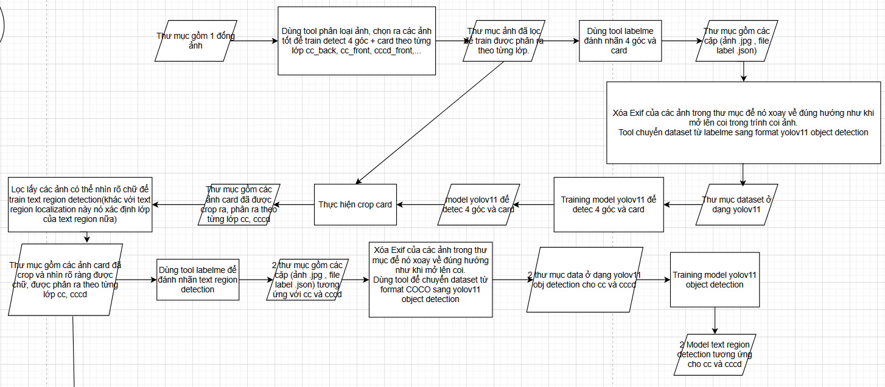
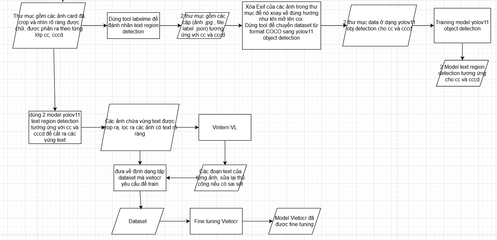

# Hệ thống OCR cho Thẻ Căn Cước Công Dân

## 📋 Tổng quan

Hệ thống trích xuất thông tin tự động từ thẻ căn cước và căn cước công dân sử dụng công nghệ OCR (Optical Character Recognition) và Deep Learning.

### Quy trình hoạt động chính:


### Tính năng chính:
- ✅ Phát hiện và định vị thẻ căn cước trong ảnh
- ✅ Trích xuất các vùng text quan trọng
- ✅ Nhận dạng ký tự và chuyển đổi thành text
- ✅ Hỗ trợ cả thẻ căn cước và căn cước công dân
- ✅ API RESTful với Swagger UI
- ✅ Hỗ trợ cả CPU và GPU

## 🛠️ Yêu cầu hệ thống

### Phần cứng tối thiểu:
- **RAM**: 8GB trở lên
- **CPU**: Intel i5 hoặc tương đương
- **GPU** (tùy chọn): NVIDIA GTX 1060 trở lên với CUDA support

### Phần mềm:
- **Python**: 3.10+
- **Conda** hoặc **Docker**
- **CUDA Toolkit** (nếu sử dụng GPU)

## 🚀 Cách triển khai

### Phương pháp 1: Sử dụng Conda Environment

#### Bước 1: Clone source code
```bash
# Di chuyển vào đúng nhánh, đúng thư mục cha của dự án.
```

#### Bước 2: Tạo và kích hoạt môi trường Conda
```bash
# Tạo môi trường mới
conda create -n venv_name python=3.11.13

# Kích hoạt môi trường
conda activate venv_name

# Cài đặt thư viện
pip install -r requirements.txt
# Có options cho GPU và CPU trong file này.
```

#### Bước 3: Cấu hình models
Chỉnh sửa file `configs.yml` để cấu hình đường dẫn đến các models:

```yaml
# Model paths configuration
model_paths:
  yolo_det_4cornercard_model_path: "model/det_4corner_card/best.onnx"
  yolo_det_textcc_model_path: "model/detcls_text_region/cc_best.onnx"
  yolo_det_textcccd_model_path: "model/detcls_text_region/cccd_best.onnx"
  vietocr_rec_textregion_model_path: "model/vietocr/"
```
**Hiện tại sử dụng 4 model.**
- Model yolov11n to 4 corner and card detection, format onnx.
- 2 model yolov11n to text regions detection lần lượt cho thẻ căn cước và căn cước công dân, format onnx.
- model VietOCR to text recognition.

**Cấu hình nâng cao** trong file `configs.py`:
- Threshold cho IoU và Confidence
- Định dạng, kích thước và hình dạng ảnh cho phép
- Tên các class
- Lựa chọn CPU/GPU cho từng model

#### Bước 4: Chạy ứng dụng
```bash
python main.py
```

#### Bước 5: Truy cập Swagger UI
Mở trình duyệt và truy cập: `http://localhost:port/docs`

### Phương pháp 2: Sử dụng Docker

```bash
# BUILD IMAGE COMMAND:
docker build \
  --build-arg PROXY_USER=$(grep PROXY_USER .env-docker | cut -d '=' -f2) \
  --build-arg PROXY_PASS=$(grep PROXY_PASS .env-docker | cut -d '=' -f2) \
  --build-arg PROXY_HOST=$(grep PROXY_HOST .env-docker | cut -d '=' -f2) \
  --build-arg PROXY_PORT=$(grep PROXY_PORT .env-docker | cut -d '=' -f2) \
  -t ocr-app .
# RUN CONTAINER COMMAND
docker run --gpus all \
  -v $(pwd)/model:/app/model \
  -v $(pwd)/src:/app/src \
  -v $(pwd)/main.py:/app/main.py \
  -v $(pwd)/configs.yml:/app/configs.yml \
  -p 8088:8088 \
  --name ocr-container \
  ocr-app

# OR RUN WITH DOCKER COMPOSE
docker compose up
```

> **Lưu ý**: Xem chi tiết trong file `Dockerfile` để biết thêm các tùy chọn cấu hình.

## 🎯 Huấn luyện Models

### Quy trình training cho YOLO models để phát hiện card, text regions:


### Quy trình finetuning VietOCR trên dataset custom:


### Các bước thực hiện:
- Chuẩn bị data theo quy trình trên.
- Chuẩn bị source code, cài môi trường, thư viện như trong file requirements.txt. Sau đó chạy mã theo quy trình trên.

*Cập nhật lần cuối: [20-11-2025]*