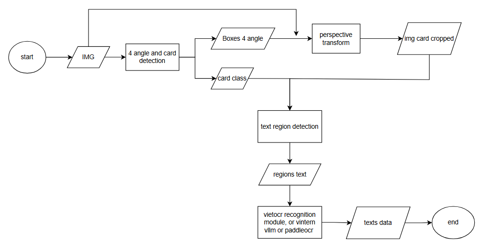

1. Tổng quan
- Hệ thống trích xuất thông tin khách hàng từ thẻ căn cước, căn cước công dân.
- Quy trình hoạt động chính:

2. Cách chạy source:
- Cách 1: dùng conda.
    - Step 1: git clone source code của repo này. Checkout vào đúng nhánh, di chuyển vào thư mục root của project.
    - Step 2: Tạo conda venv, kích hoạt. Cài các thư viện trong file requirements.txt. có options cho GPU và CPU
    - Step 3:
        - Trong file configs.yml chỉnh sửa các path tới model. Hiện tại sử dụng 5 model.
            - model yolov11n to 4 corner and card detection, format onnx.
            - 2 model yolov11n to text regions detection lần lượt cho thẻ căn cước và căn cước công dân, format onnx.
            - model VietOCR to text recognition.
            - model PP-OCRv4-mobile-rec từ paddle ocr để nhận dạng mrz do VietOCR pretrained chưa nhận diện tốt trường này, sau này sẽ finetuning VietOCR tốt để khỏi cần dùng model này. 
        - Các configs nâng cao như chỉnh iou, conf threshold, kích thước, hình dạng ảnh cho phép, class name, dùng GPU hay GPU cho từng model thì chỉnh trong file configs.py
    - Step 4: chạy app với lệnh python main.py
    - Step 5: mở swaggerUI để test api.
- Cách 2: dùng docker
    Xem hướng dẫn trong dockerfile
3. Training model.
- Quy trình huấn luyện các model yolo:
images\yolotrainingflow.png
- Chuẩn bị data theo quy trình trên.
- Chuẩn bị source code, cài môi trường, thư viện như trong file requirements.txt. Sau đó chạy mã theo quy trình trên.